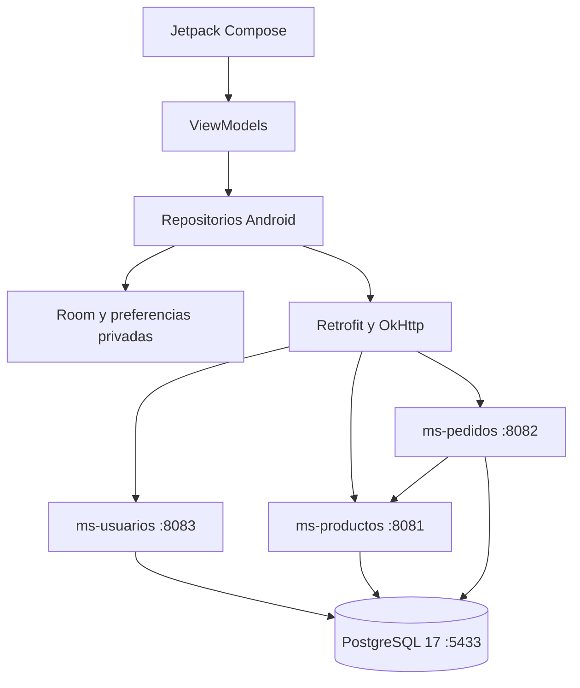
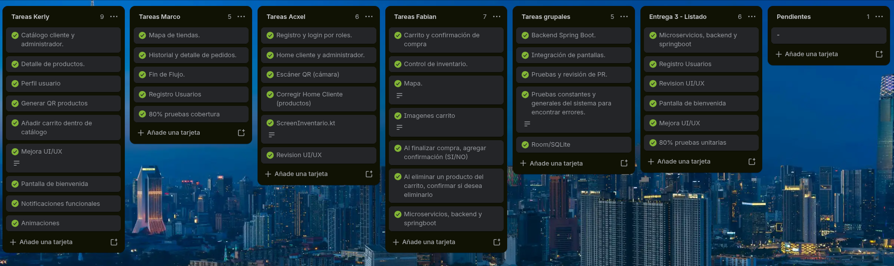

# OYL Frutos Secos — Aplicación Móvil

> Asignatura **DSY1105 — Desarrollo de Aplicaciones Móviles** · Duoc UC
> Docente: Cristian Gómez Vega

Aplicación Android nativa para la tienda **OYL Frutos Secos**, construida en Kotlin con
Jetpack Compose y respaldada por un backend propio de tres microservicios en Spring Boot.

| Recurso | Enlace |
|---|---|
| **Aplicación** | https://github.com/AcxelGonzalez/APP_Movil_Frutos |
| **Backend** | https://github.com/fabcornejom/OYL-Backend |
| **Tablero Trello** | https://trello.com/b/CZow21QV/proyecto-app |
| **APK firmado** | [`entrega/app-release.apk`](entrega/app-release.apk) |
| **Almacén de claves** | [`keystore/oyl.jks`](keystore/oyl.jks) |

---

## Índice

1. [El caso](#1-el-caso)
2. [Integrantes](#2-integrantes)
3. [Tecnologías](#3-tecnologías)
4. [Arquitectura](#4-arquitectura)
5. [Modelo de datos](#5-modelo-de-datos)
6. [Funcionalidades](#6-funcionalidades)
7. [Microservicios y endpoints](#7-microservicios-y-endpoints)
8. [Instalación paso a paso](#8-instalación-paso-a-paso)
9. [Problemas frecuentes](#9-problemas-frecuentes)
10. [Pruebas y cobertura](#10-pruebas-y-cobertura)
11. [Firma digital](#11-firma-digital)
12. [Generación del APK](#12-generación-del-apk)
13. [Estructura del repositorio](#13-estructura-del-repositorio)
14. [Gestión del proyecto](#14-gestión-del-proyecto)
15. [Alcance y límites](#15-alcance-y-límites)

---

## 1. El caso

**OYL Frutos Secos** es un emprendimiento comercial chileno dedicado a la venta minorista de
frutos secos, semillas, deshidratados y productos naturales. Opera con una tienda física y,
en paralelo, atiende pedidos por canales informales como WhatsApp Business y Mercado Libre.

### El problema

Los dos frentes de venta funcionan de forma independiente y sin un inventario común. Cuando
un cliente consulta por chat si hay stock de un producto, la administración debe ir a revisar
visualmente los estantes, confirmar el precio, apartar el producto y anotar los datos de la
entrega en papel.

Esto produce tres consecuencias:

- **Descuadres de stock** entre lo que figura disponible y lo que realmente hay en bodega.
- **Sobreventa** de productos agotados, porque dos canales pueden comprometer la misma unidad.
- **Tiempo administrativo perdido** en revisar existencias y responder mensajes uno a uno.

### La solución

Una aplicación móvil con dos perfiles conectados a un único backend, de modo que cualquier
movimiento quede reflejado de inmediato para todos.

El **cliente** consulta un catálogo con disponibilidad real, arma su pedido y lo envía sin
depender de un chat. El **administrador** gestiona el inventario desde el local, recibe los
pedidos entrantes y los procesa hasta la entrega. El stock se descuenta **una sola vez**, en
el servidor, en el momento en que se registra la compra.

### Restricciones del caso

- El entregable es un **MVP académico de simulación**, no un producto para publicar en tiendas.
- Se trabaja exclusivamente con **datos sintéticos**. No se usan registros reales, datos
  comerciales internos ni credenciales productivas, conforme a las leyes chilenas
  **N.º 21.719** y **N.º 19.628** sobre protección de datos personales.
- No hay pasarela de pago ni despacho real.

---

## 2. Integrantes

- **Acxel González**
- **Kerly Dugarte**
- **Marco Carrasco**
- **Fabián Cornejo**

El trabajo se repartió por pantalla desde el inicio del proyecto y se integró mediante ramas
separadas por persona.

---

## 3. Tecnologías

### Aplicación móvil

| Componente | Versión |
|---|---|
| Lenguaje | Kotlin 1.8.10 |
| Interfaz | Jetpack Compose · BOM 2023.03.00 · Material 3 |
| Arquitectura | MVVM — Pantalla → ViewModel → Repositorio → API |
| Cliente HTTP | Retrofit 2.9.0 + Gson · OkHttp logging-interceptor 4.12.0 |
| Persistencia local | Room 2.5.2 |
| Mapas | osmdroid 6.1.20 |
| Códigos QR | ZXing 3.5.3 (generación) · Google Code Scanner 16.1.0 (lectura) |
| Compilación | Gradle 8.2 · AGP 8.2.2 · **JDK 17** |
| SDK | compileSdk 34 · targetSdk 34 · minSdk 24 (Android 7) |
| Pruebas | JUnit 4.13.2 · MockK 1.13.4 · coroutines-test 1.6.4 |
| Cobertura | JaCoCo 0.8.13 |

### Backend

| Componente | Versión |
|---|---|
| Framework | Spring Boot 4.1.2 |
| Lenguaje | Java 25 |
| Base de datos | PostgreSQL 17 |
| Contenedores | Docker · Docker Compose |
| Seguridad | BCrypt para contraseñas · JWT para autorización |

> El JDK 25 del backend vive dentro de los contenedores. Gradle debe seguir usando **JDK 17**.

---

## 4. Arquitectura



### Por qué tres microservicios

La división sigue los tres dominios del negocio que aparecen en el caso: el **catálogo**, las
**transacciones** y las **personas**. Cada uno cambia por motivos distintos y a ritmos
distintos, que es el criterio habitual para separar servicios.

Cada microservicio tiene **su propia base de datos** dentro del mismo motor PostgreSQL.
Ninguno puede leer las tablas de otro: si necesita un dato, lo pide por HTTP. Esto evita que
un cambio en el esquema de uno rompa a los demás.

### Compra y descuento de stock

`ms-pedidos` es el único que llama a otro microservicio. Al registrar una compra:

```
La app guarda el intento con una clave única antes de enviar nada
  → ms-pedidos solicita la compra de stock a ms-productos
  → se comprueban precio esperado, disponibilidad y cantidades
  → se registra el descuento y después el pedido
  → la app muestra el comprobante y vacía lo comprado del carrito
```

El **precio nunca se acepta desde el teléfono**: la app envía el precio que el cliente vio, y
el servidor lo compara con el actual antes de calcular el total con sus propios datos.

El stock se descuenta al registrar la compra, **antes de la confirmación administrativa**.
Avanzar el estado del pedido no vuelve a descontarlo.

### Operaciones recuperables

Una respuesta perdida no demuestra que la compra haya fallado. La aplicación conserva el
intento con su clave única y permite **consultar su resultado** o **continuar el mismo
intento**, con idéntica clave y contenido. Abrir una pantalla o reiniciar la app no reenvía
nada automáticamente.

Es la razón de los endpoints `/solicitudes/{clave}` y `/movimientos-stock/{clave}`: ante la
duda, se pregunta por la operación anterior en vez de crear una nueva.

Los ajustes de inventario y las cancelaciones conservan registros locales recuperables de la
misma forma.

### Persistencia local

| Información | Dónde vive |
|---|---|
| Usuarios y perfil remoto | PostgreSQL, `ms-usuarios` |
| Productos, stock, fotos y comprobantes | PostgreSQL, `ms-productos` |
| Pedidos, detalles, cancelaciones | PostgreSQL, `ms-pedidos` |
| Caché de catálogo y carrito | Room `oyl_frutos_secos.db`, versión 7 |
| Perfiles locales y operaciones pendientes | Room `oyl_perfiles_remotos.db`, versión 5 |
| Avatar | Archivo privado del teléfono; no se sube al servidor |
| Sesión | Preferencias cifradas con Android Keystore |

El servidor es siempre la fuente de verdad. La caché permite consultar el catálogo con un
aviso de antigüedad, pero comprar, modificar inventario y cambiar estados requieren los
servicios disponibles.

### Seguridad

- **Login y registro son públicos.** El resto de las APIs exige un token JWT `Bearer` y
  autorización por rol o por propietario del recurso.
- Las contraseñas se cifran con **BCrypt** antes de guardarse. Al iniciar sesión no se
  comparan contraseñas: se vuelve a aplicar el algoritmo y se comparan los resultados.
- La contraseña **nunca** aparece en las respuestas del servidor, y la app no la conserva.
- El registro público siempre crea usuarios con rol `CLIENTE`. Aunque una petición incluya
  `"rol": "ADMIN"`, el servidor la ignora.
- Ante credenciales incorrectas el mensaje es el mismo falle el alias o la contraseña, para
  no revelar qué usuarios existen.
- El entorno académico usa HTTP sin TLS. Un despliegue real exigiría revisar el transporte,
  las cuentas de demostración y la distribución de la firma.

---

## 5. Modelo de datos

### Producto

| Campo | Descripción |
|---|---|
| `id` | Identificador único |
| `nombre`, `codigo` | Identificación comercial |
| `categoria` | Frutos secos · Semillas · Deshidratados |
| `precio` | Precio unitario |
| `stock`, `stockMinimo` | Existencias y umbral de aviso |
| `disponible` | Permite retirar un producto sin borrarlo |
| `imagen` | Recurso local o fotografía subida por el administrador |

### Pedido

| Campo | Descripción |
|---|---|
| `id` | Identificador de la transacción |
| `fecha` | Fecha y hora del requerimiento |
| `detalles` | Artículos con cantidad y precio unitario |
| `total` | Monto consolidado, calculado por el servidor |
| `estado` | Estado actual de la solicitud |

### Usuario

| Campo | Descripción |
|---|---|
| `id` | Identificador único |
| `nombre`, `alias`, `correo` | Datos de identificación |
| `telefono`, `direccion` | Datos de contacto |
| `contrasena` | Cifrada con BCrypt, nunca se devuelve |
| `rol` | `ADMIN` o `CLIENTE` |

---

## 6. Funcionalidades

### Perfil Cliente

- Registro de cuenta propia e inicio de sesión
- Catálogo con filtros por categoría, fotografías, precio y disponibilidad real
- Detalle de cada producto
- Carrito con control de cantidades y validación de stock
- Confirmación de compra con domicilio o punto de retiro en el mapa
- Comprobante de compra recuperable ante una respuesta perdida
- Historial de pedidos propios con su estado actual
- Solicitud de cancelación mientras el pedido siga pendiente de validación
- Edición de perfil y avatar local

### Perfil Administrador

- Inventario completo: alta, edición y retiro de productos, con fotografía
- Registro de entradas y salidas de stock con comprobante
- Aviso de productos con stock bajo
- Generación de códigos QR por producto
- Bandeja con los pedidos entrantes de todos los clientes
- Preparación por escáner: cada lectura válida acredita una unidad
- Avance del pedido por sus estados hasta la entrega

### Ciclo de vida de un pedido

```
PENDIENTE_VALIDACIÓN  →  CONFIRMADO  →  PREPARADO  →  ENTREGADO
```

El pedido nace en `PENDIENTE_VALIDACION` cuando el cliente lo envía. El administrador lo hace
avanzar **un paso a la vez**: el backend rechaza los saltos y los retrocesos.

Para pasar a `PREPARADO`, la aplicación exige haber escaneado los códigos QR hasta completar
las cantidades del pedido. Un QR ajeno o una lectura de más se rechazan.

Un pedido solo puede cancelarse mientras está en `PENDIENTE_VALIDACION`. El backend devuelve
el stock **una sola vez**, retira el pedido de las listas activas y conserva el registro de la
cancelación. La devolución contempla incluso productos retirados del catálogo.

---

## 7. Microservicios y endpoints

Salvo el registro y el inicio de sesión, todos los endpoints requieren cabecera
`Authorization: Bearer <token>`.

### ms-productos — puerto 8081

| Método | Endpoint | Descripción |
|---|---|---|
| `GET` | `/api/productos` | Lista el catálogo |
| `GET` | `/api/productos/{id}` | Obtiene un producto |
| `GET` | `/api/productos/stock-bajo` | Productos bajo el umbral |
| `POST` | `/api/productos` | Crea un producto |
| `PUT` | `/api/productos/{id}` | Edita un producto |
| `PATCH` | `/api/productos/{id}/stock` | Ajusta el stock |
| `DELETE` | `/api/productos/{id}` | Retira un producto |
| `POST` | `/api/productos/con-foto` | Crea un producto con fotografía |
| `PUT` | `/api/productos/{id}/con-foto` | Edita un producto con fotografía |
| `GET` | `/api/productos/{id}/foto/{version}` | Descarga la fotografía |
| `POST` | `/api/productos/movimientos-stock/{clave}` | Registra entrada o salida |
| `GET` | `/api/productos/movimientos-stock/{clave}` | Consulta un movimiento anterior |
| `POST` | `/api/productos/compras-stock` | Descuenta stock por una compra |
| `POST` | `/api/productos/devoluciones-stock` | Devuelve stock por una cancelación |

### ms-pedidos — puerto 8082

| Método | Endpoint | Descripción |
|---|---|---|
| `POST` | `/api/pedidos` | Registra un pedido y descuenta el stock |
| `GET` | `/api/pedidos/solicitudes/{clave}` | Consulta el resultado de un intento |
| `GET` | `/api/pedidos` | Lista todos los pedidos (administrador) |
| `GET` | `/api/pedidos/{id}` | Obtiene un pedido |
| `GET` | `/api/pedidos/usuario/{usuarioId}` | Pedidos de un cliente |
| `PATCH` | `/api/pedidos/{id}/estado` | Avanza al siguiente estado |
| `POST` | `/api/pedidos/{id}/cancelacion` | Cancela y devuelve el stock |
| `GET` | `/api/pedidos/{id}/cancelacion` | Consulta una cancelación anterior |
| `DELETE` | `/api/pedidos/{id}` | Elimina un pedido |

### ms-usuarios — puerto 8083

| Método | Endpoint | Descripción |
|---|---|---|
| `POST` | `/api/usuarios/registro` | Crea una cuenta de cliente *(público)* |
| `POST` | `/api/usuarios/login` | Valida credenciales y entrega el token *(público)* |
| `GET` | `/api/usuarios` | Lista los usuarios |
| `GET` | `/api/usuarios/{id}` | Obtiene un usuario |
| `PUT` | `/api/usuarios/{id}` | Edita los datos de contacto |
| `DELETE` | `/api/usuarios/{id}` | Elimina un usuario |

> Un `401` al abrir un endpoint en el navegador **no significa que el servicio esté caído**:
> significa que requiere autenticación.

---

## 8. Instalación paso a paso

### 8.1 Requisitos previos

| Herramienta | Para qué |
|---|---|
| **Docker** y **Docker Compose** | Levantar el backend |
| **Android Studio** (Ladybug o superior) con **SDK 34** | Compilar y ejecutar la app |
| **JDK 17** configurado como Gradle JDK | Compilar |
| **Git** | Clonar los repositorios |

No hace falta instalar Java 25, Maven ni PostgreSQL: todo eso vive dentro de los contenedores.

---

### 8.2 Instalar Docker

#### Windows

Docker en Windows funciona sobre **WSL 2**, un subsistema que ejecuta Linux dentro de Windows.

**Requisitos:** Windows 10 versión 22H2 o Windows 11 versión 23H2 en adelante, 8 GB de RAM y
virtualización habilitada en la BIOS.

1. **Instalar WSL 2.** Abre PowerShell **como administrador**:

   ```powershell
   wsl --install
   wsl --update
   ```

   Reinicia el computador si te lo pide.
   → [Guía oficial de instalación de WSL](https://learn.microsoft.com/windows/wsl/install)

2. **Descargar Docker Desktop:**
   → [Install Docker Desktop on Windows](https://docs.docker.com/desktop/setup/install/windows-install/)

3. **Ejecutar el instalador.** En la pantalla de configuración, marca **Use WSL 2 instead of
   Hyper-V**.

4. **Abrir Docker Desktop.** El ícono de la ballena debe quedar fijo, sin animación.

5. **Verificar:**

   ```powershell
   docker --version
   docker compose version
   ```

#### Linux (Ubuntu, Pop!_OS, Mint y derivados)

1. **Agregar el repositorio oficial:**

   ```bash
   sudo apt update
   sudo apt install ca-certificates curl
   sudo install -m 0755 -d /etc/apt/keyrings
   sudo curl -fsSL https://download.docker.com/linux/ubuntu/gpg -o /etc/apt/keyrings/docker.asc
   sudo chmod a+r /etc/apt/keyrings/docker.asc

   sudo tee /etc/apt/sources.list.d/docker.sources <<EOF
   Types: deb
   URIs: https://download.docker.com/linux/ubuntu
   Suites: $(. /etc/os-release && echo "${UBUNTU_CODENAME:-$VERSION_CODENAME}")
   Components: stable
   Architectures: $(dpkg --print-architecture)
   Signed-By: /etc/apt/keyrings/docker.asc
   EOF

   sudo apt update
   ```

2. **Instalar Docker y el plugin de Compose:**

   ```bash
   sudo apt install docker-ce docker-ce-cli containerd.io docker-buildx-plugin docker-compose-plugin
   ```

3. **Usar Docker sin `sudo`** (recomendable):

   ```bash
   sudo usermod -aG docker $USER
   ```

   Cierra la sesión y vuelve a entrar.

4. **Verificar:**

   ```bash
   docker --version
   docker compose version
   docker run hello-world
   ```

   → [Guía oficial para Ubuntu](https://docs.docker.com/engine/install/ubuntu/)
   → [Pasos posteriores a la instalación](https://docs.docker.com/engine/install/linux-postinstall/)

> Si tenías el paquete `docker.io` de los repositorios de Ubuntu, desinstálalo antes: entra en
> conflicto con la versión oficial.

#### macOS

→ [Install Docker Desktop on Mac](https://docs.docker.com/desktop/setup/install/mac-install/),
eligiendo la versión de tu procesador (Apple Silicon o Intel).

---

### 8.3 Levantar el backend

```bash
git clone https://github.com/fabcornejom/OYL-Backend.git
cd OYL-Backend
java tools/PrepararSeguridad.java
docker compose up -d --build
```

> **El paso de las claves no es opcional.** El backend firma los tokens JWT con un par de
> claves RSA que, por seguridad, no se versionan en Git: cada persona las genera en su
> computador la primera vez. Si se omite, `docker compose` falla con
> `bind source path does not exist: .oyl-secrets/jwt-public.pem`.
>
> Si no tienes Java instalado, la herramienta puede ejecutarse dentro de un contenedor:
>
> ```bash
> docker run --rm --user "$(id -u):$(id -g)" -v "$PWD:/workspace" -w /workspace \
>   eclipse-temurin:25-jdk java tools/PrepararSeguridad.java
> ```
>
> Genera `.oyl-secrets/` con la clave privada que firma los tokens, la pública que los
> verifica y la credencial interna entre `ms-pedidos` y `ms-productos`. **No las borres ni
> las regeneres después**: cambiar las claves invalida las sesiones abiertas y puede dejar
> a los servicios sin poder comunicarse entre ellos.

La primera vez tarda **varios minutos**: Docker descarga las imágenes base y compila los tres
microservicios con Maven.

El comando levanta **cuatro contenedores**:

| Contenedor | Puerto | Función |
|---|---|---|
| `postgres` | 5433 | Base de datos |
| `ms-productos` | 8081 | Catálogo e inventario |
| `ms-pedidos` | 8082 | Pedidos y estados |
| `ms-usuarios` | 8083 | Cuentas y autenticación |

> Se usa el puerto **5433** en lugar del 5432 habitual para no chocar con una instalación
> local de PostgreSQL.

**Comprobar que los cuatro están arriba:**

```bash
docker compose ps
```

**Comprobar que responden:**

```bash
curl -s -o /dev/null -w "%{http_code}\n" http://localhost:8081/api/productos
```

Debe devolver **401**. Eso es correcto: el servicio está en marcha y protegido. Los endpoints
exigen token, así que abrirlos en el navegador sin iniciar sesión devuelve ese código. Un
error de conexión sí indicaría que el servicio no está disponible.

Un contenedor encendido no demuestra por sí solo que la API esté lista. Para detalles
adicionales, consulta el [README del backend](https://github.com/fabcornejom/OYL-Backend).

**Detener:**

```bash
docker compose down        # conserva los datos
docker compose down -v     # borra la base y vuelve al estado inicial
```

---

### 8.4 Ejecutar la aplicación

```bash
git clone https://github.com/AcxelGonzalez/APP_Movil_Frutos.git
```

1. Abre la carpeta en **Android Studio**.
2. Configura **Gradle JDK 17** y espera la sincronización.
3. Selecciona un emulador con **API 24 o superior**.
4. Pulsa **Run**.

Android Studio genera `local.properties` con la ruta del SDK de ese computador. No copies ese
archivo desde otro equipo.

#### Dirección del backend

La dirección **no se edita en el código**. Se pasa como propiedad de Gradle
`oylBackendHost`, que genera `BuildConfig.OYL_BACKEND_HOST`. El valor incluye protocolo y
host, **sin puerto, ruta ni barra final**: Retrofit añade cada puerto.

| Entorno | Host |
|---|---|
| Emulador con el backend en el mismo PC | `http://10.0.2.2` *(valor por omisión)* |
| Teléfono por USB con `adb reverse` | `http://127.0.0.1` |
| Teléfono y PC en la misma WiFi | IP del PC, por ejemplo `http://192.168.1.8` |

`10.0.2.2` es la dirección con la que el emulador se refiere al computador donde corre. No es
`localhost`, porque para el emulador `localhost` es él mismo.

Para el emulador no hay que hacer nada: ese es el valor por omisión.

Para un **teléfono por USB**:

```bash
./gradlew assembleDebug -PoylBackendHost=http://127.0.0.1
adb devices
adb -s SERIAL reverse tcp:8081 tcp:8081
adb -s SERIAL reverse tcp:8082 tcp:8082
adb -s SERIAL reverse tcp:8083 tcp:8083
adb -s SERIAL install -r app/build/outputs/apk/debug/app-debug.apk
```

En Windows, `.\gradlew.bat`. Reemplaza `SERIAL` por el que muestre `adb devices`.

Para usar el botón **Run** con otro host, añade `oylBackendHost=http://127.0.0.1` al
`gradle.properties` personal de tu `GRADLE_USER_HOME` y sincroniza. El host queda dentro del
APK, así que cambiarlo exige recompilar.

---

### 8.5 Cuentas de prueba

| Usuario | Contraseña | Rol |
|---|---|---|
| `admin` | `admin` | Administrador |
| `cliente` | `cliente` | Cliente |

Ambas se crean automáticamente al levantar `ms-usuarios`, y se vuelven a crear si borras la
base de datos. Son cuentas de demostración del entorno académico y no deben existir en un
despliegue real.

También puedes crear cuentas nuevas desde **Crear una cuenta** en la pantalla de inicio de
sesión. Todas reciben rol `CLIENTE`.

---

### 8.6 Recorrido de demostración

El recorrido completo se hace desde la aplicación:

1. Entra como **cliente**, agrega productos al carrito y confirma la compra.
2. Revisa el comprobante y comprueba que el carrito quedó actualizado.
3. Abre el catálogo: el stock del producto comprado bajó.
4. Cierra sesión y entra como **admin**: el pedido aparece en la bandeja en
   `PENDIENTE_VALIDACION`.
5. Confírmalo, escanea los códigos QR de los productos y márcalo como preparado.
6. Entrégalo y comprueba que el stock **no** se descontó una segunda vez.

#### Ver los datos del servidor

Como los endpoints exigen token, el navegador ya no sirve para esto. Hay dos formas.

**Consultar la base de datos directamente.** Es la más cómoda para comprobar cambios:

```bash
docker compose exec postgres psql -U postgres -d oyl_productos \
  -c "select id, nombre, stock from productos order by id;"

docker compose exec postgres psql -U postgres -d oyl_pedidos \
  -c "select id, usuario_id, estado, total from pedidos order by id desc limit 10;"
```

Usuario y contraseña son `postgres`. Las tres bases son `oyl_productos`, `oyl_pedidos` y
`oyl_usuarios`. Con un cliente gráfico como DBeaver, la conexión es `localhost:5433` con esas
mismas credenciales.

**Consultar la API con token.** Si quieres mostrar los microservicios respondiendo:

```bash
TOKEN=$(curl -s -X POST http://localhost:8083/api/usuarios/login \
  -H "Content-Type: application/json" \
  -d '{"alias":"admin","contrasena":"admin"}' \
  | python3 -c "import sys,json; print(json.load(sys.stdin)['accessToken'])")

curl -s -H "Authorization: Bearer $TOKEN" http://localhost:8081/api/productos | python3 -m json.tool
```

El token dura una hora. El repositorio del backend incluye además
`oyl_backend.postman_collection.json`, que deja todas las peticiones listas en Postman.

---

## 9. Problemas frecuentes

<details>
<summary><strong>«port is already allocated» al levantar los contenedores</strong></summary>

El puerto 5433 está ocupado por otro contenedor, normalmente una copia anterior del proyecto.

```bash
docker ps --format "table {{.Names}}\t{{.Ports}}"
```

Apaga el contenedor que ocupa el puerto desde su propia carpeta con `docker compose down` y
vuelve a intentarlo.
</details>

<details>
<summary><strong>«no configuration file provided: not found»</strong></summary>

Estás ejecutando `docker compose` desde una carpeta que no contiene `docker-compose.yml`.
Sitúate en la raíz del repositorio del backend.
</details>

<details>
<summary><strong>Gradle falla con «Unknown Kotlin JVM target: 21»</strong></summary>

La terminal está usando el JDK del sistema. Ejecuta las tareas **desde Android Studio**, que
usa su propio JDK 17, o indica la ruta:

```bash
./gradlew test -Dorg.gradle.java.home=$HOME/android-studio/jbr
```
</details>

<details>
<summary><strong>La app no conecta con el servidor</strong></summary>

1. `docker compose ps`: los cuatro contenedores deben estar `Up`.
2. Abre `http://localhost:8081/api/productos` en el navegador del computador.
3. Revisa con qué `oylBackendHost` se compiló el APK instalado.
4. Por USB, confirma que los tres túneles de `adb reverse` siguen activos.
5. Por WiFi, confirma que la red permita llegar a los tres puertos del PC.

`localhost` dentro del teléfono se refiere al teléfono, no al computador.
</details>

<details>
<summary><strong>El catálogo aparece con aviso de antigüedad</strong></summary>

Falló la consulta remota y se está mostrando la caché local. Actualiza antes de comprar con
esos precios.
</details>

<details>
<summary><strong>Una foto antigua devuelve 404</strong></summary>

Cambió la versión de la imagen o el producto fue retirado. Refresca el catálogo.
</details>

<details>
<summary><strong>El lector QR no abre</strong></summary>

Requiere Google Play services y descarga su módulo la primera vez. El teléfono debe estar
desbloqueado.
</details>

<details>
<summary><strong>Una operación quedó con resultado incierto</strong></summary>

No crees una segunda compra ni borres los datos de la app. Usa la opción de **consultar** o
**continuar el mismo intento**: conserva la clave original y pregunta al servidor qué pasó.
</details>

---

## 10. Pruebas y cobertura

### Pruebas unitarias (JVM)

Ubicación: `app/src/test/`

No requieren emulador ni servidor. Cubren la lógica de negocio: validaciones, cuentas y
sesiones, autorización HTTP, carrito, inventario, compras recuperables, cancelaciones,
perfiles y avatar. Las conexiones reales y los DAO se reemplazan por dobles de prueba con
**MockK**, de modo que las pruebas pasan aunque los contenedores estén apagados.

Desde Android Studio: clic derecho sobre el paquete `com.example.oyl_fs (test)` →
**Run 'Tests in com.example.oyl_fs'**.

Desde la terminal:

```bash
./gradlew testDebugUnitTest
./gradlew jacocoDebugUnitTestCoverageVerification
./gradlew lintDebug
```

### Cobertura

La medición se hace con **JaCoCo** sobre la lógica de negocio: los paquetes `viewmodel`,
`repository`, `model`, `util`, `network` y `data/local`. Quedan fuera las pantallas de Compose
y las clases `*_Impl*` que Room genera automáticamente.

Esa exclusión es deliberada y está escrita en `app/build.gradle.kts`. Las pantallas no pueden
ejecutarse fuera de un dispositivo, así que incluirlas en el denominador mediría algo que
ninguna prueba unitaria puede cubrir. La configuración es verificable por cualquiera que abra
el archivo.

La tarea de verificación **falla si la cobertura de líneas baja del 80 %**.

| Informe | Archivo |
|---|---|
| Resultados | `app/build/reports/tests/testDebugUnitTest/index.html` |
| Cobertura HTML | `app/build/reports/jacoco/jacocoDebugUnitTestReport/html/index.html` |
| Cobertura XML | `app/build/reports/jacoco/jacocoDebugUnitTestReport/jacocoDebugUnitTestReport.xml` |
| Lint | `app/build/reports/lint-results-debug.html` |

**Última ejecución registrada (24-11-2026):** 242 pruebas aprobadas, sin fallos ni omisiones.
**3.202 de 3.921 líneas, 81,66 %**, por encima del umbral. Lint: 0 errores y 41 advertencias.

> Estas cifras corresponden a una ejecución concreta. Después de cambiar código hay que
> regenerarlas.

### Pruebas instrumentadas

Ubicación: `app/src/androidTest/`

Validan la base de datos Room, sus migraciones entre versiones y pantallas de Compose.
Requieren un emulador o teléfono con la pantalla desbloqueada.

```bash
./gradlew connectedDebugAndroidTest
```

No se suman a la cobertura: JaCoCo mide la ejecución en la máquina virtual de Java, y estas
corren dentro del dispositivo.

---

## 11. Firma digital

La aplicación se firma con un almacén de claves propio, en `keystore/oyl.jks`.

### Para qué sirve

Una aplicación sin firmar no puede instalarse fuera del modo desarrollador. La firma cumple
dos funciones:

- **Identifica el origen.** Android verifica la firma al instalar. Si alguien modifica el APK
  después de firmarlo, la verificación falla y el sistema lo rechaza.
- **Habilita las actualizaciones.** Solo se puede instalar una versión nueva sobre otra si
  ambas están firmadas con la misma clave.

### Pasos seguidos

1. Menú **Build → Generate Signed App Bundle / APK**, opción **APK**.
2. Botón **Create new...** para generar el almacén de claves.
3. Se completaron los datos del certificado: ruta, contraseña, alias `oyl` y validez de 25 años.
4. Se seleccionó la variante **release**.

### Evidencia

| | |
|---|---|
|  |  |
|  |  |
|  |  |
|  |  |
|  | |

### Configuración en Gradle

```kotlin
signingConfigs {
    create("release") {
        storeFile = file("../keystore/oyl.jks")
        storePassword = "oyl2026"
        keyAlias = "oyl"
        keyPassword = "oyl2026"
    }
}

buildTypes {
    release {
        signingConfig = signingConfigs.getByName("release")
        isMinifyEnabled = false
        proguardFiles(
            getDefaultProguardFile("proguard-android-optimize.txt"),
            "proguard-rules.pro"
        )
    }
}
```

> **Nota sobre buenas prácticas.** Incluir el almacén de claves y sus contraseñas en el
> repositorio no es recomendable: quien tenga ese archivo puede firmar actualizaciones en
> nombre de la aplicación. Aquí se entregan porque la evaluación los solicita como evidencia.
> En un proyecto real el `.jks` se guarda fuera del repositorio y las contraseñas se leen
> desde variables de entorno. Esta firma no debe reutilizarse en una aplicación productiva.

---

## 12. Generación del APK

### Desde Android Studio

1. En **Build Variants**, cambiar el módulo `app` a la variante **release**.
2. Menú **Build → Build Bundle(s) / APK(s) → Build APK(s)**.

### Desde la terminal

```bash
./gradlew assembleRelease -PoylBackendHost=http://10.0.2.2
```

El archivo se genera en `app/build/outputs/apk/release/app-release.apk`.

### Verificar la firma

Que el nombre sea `app-release.apk` y no `app-release-unsigned.apk` es un buen indicio, pero
no una prueba. Para confirmarlo:

```bash
apksigner verify --verbose --print-certs app/build/outputs/apk/release/app-release.apk
```

`apksigner` está en los Build Tools del SDK; usa su ruta completa si no está en el PATH.

El APK entregado se encuentra en **[`entrega/app-release.apk`](entrega/app-release.apk)**.

### Evidencia

| | |
|---|---|
|  |  |

> Si al instalar aparece `INSTALL_FAILED_UPDATE_INCOMPATIBLE`, es que ya hay una versión
> firmada con otra clave, normalmente una de depuración. No desinstales sin pensarlo: se
> perderían los datos locales de esa instalación.

---

## 13. Estructura del repositorio

```
APP_Movil_Frutos/
├── app/
│   └── src/
│       ├── main/
│       │   ├── java/com/example/oyl_fs/
│       │   │   ├── data/local/      Room: entidades, DAOs, mappers y migraciones
│       │   │   ├── model/           Modelos de dominio y reglas
│       │   │   ├── network/         Retrofit: contratos, DTOs y autorización
│       │   │   ├── repository/      Acceso a datos y recuperación de operaciones
│       │   │   ├── screens/         Pantallas en Jetpack Compose
│       │   │   ├── ui/              Tema, colores y componentes
│       │   │   ├── util/            Fotos, avatar, QR, cifrado y validaciones
│       │   │   ├── viewmodel/       Lógica de presentación
│       │   │   └── MainActivity.kt  Navegación entre pantallas
│       │   └── res/                 Imágenes, íconos y estilos
│       ├── test/                    Pruebas unitarias (JVM)
│       └── androidTest/             Pruebas instrumentadas (dispositivo)
├── docs/                            Bitácoras de avance y auditorías internas
├── entrega/
│   ├── app-release.apk              APK firmado
│   ├── evidencias-apk/              Capturas de la generación del APK
│   └── evidencias-firma/            Capturas de la generación de la firma
├── keystore/
│   └── oyl.jks                      Almacén de claves de firma
└── build.gradle.kts
```

### Paleta de colores

| | Color | Código | Uso |
|---|---|---|---|
|  | Crema | `#FFF5E7` | Fondo general de las pantallas |
|  | Café claro | `#92623D` | Botones y elementos destacados |
|  | Café oscuro | `#4B2E15` | Textos y barras superiores |
|  | Marfil | `#FFFBF5` | Campos de formulario |
|  | Blanco | `#FFFFFF` | Tarjetas y contenedores |

---

## 14. Gestión del proyecto

### Ramas

| Rama | Propósito |
|---|---|
| `main` | Versión estable |
| `desarrollo` | Integración del trabajo del equipo |
| `desarrollo-<nombre>` | Rama de trabajo individual de cada integrante |

Cada integrante trabaja en su propia rama y la integra a `desarrollo` cuando sus cambios están
probados. Así se evitan conflictos entre pantallas que se desarrollan en paralelo.

Antes de integrar: revisar el estado, hacer `fetch` y comparar. No se usa `push` forzado.

### Tablero Trello

El avance se gestionó en [este tablero](https://trello.com/b/CZow21QV/proyecto-app), con
columnas por etapa y tarjetas por funcionalidad y responsable.
 

---

## 15. Alcance y límites

Lo que **sí** está implementado y verificado está descrito en las secciones anteriores. Lo que
queda fuera, por decisión del equipo o por el alcance académico:

- **Notificaciones locales**, sin integración push con Firebase.
- **API externa adicional excluida** por decisión del equipo. El mapa y las bibliotecas de QR
  no se presentan como evidencia de ese indicador.
- **Sin pasarela de pago ni despacho real.**
- **HTTP sin TLS**, propio del entorno académico.
- Las listas se actualizan por consulta, **sin sincronización automática entre dispositivos**.
- Permanecen **41 advertencias de lint**, ninguna de ellas un error.
- Pendientes de comprobar: instalación completa en un entorno limpio, uso concurrente desde
  dos teléfonos y corte real de conexión durante un envío.

El RUT, el apellido complementario y los datos de contacto o punto de retiro acordados al
comprar se guardan **solo en el teléfono**, no en el servidor. El avatar también.

---

<p align="center">
  Duoc UC · Escuela de Informática y Telecomunicaciones<br>
  DSY1105 — Desarrollo de Aplicaciones Móviles · Docente: Cristian Gómez Vega
</p>
