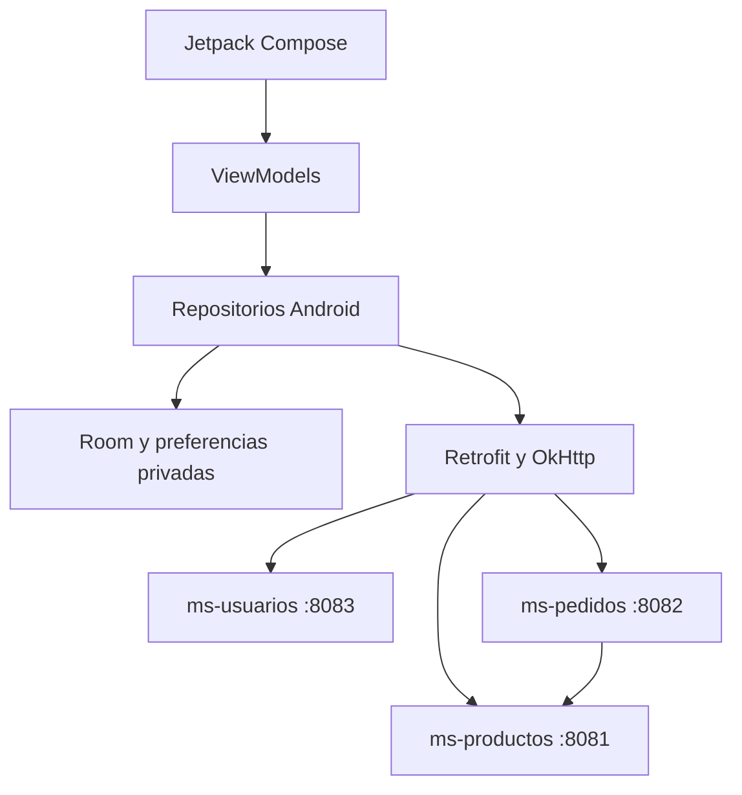

# OYL Frutos Secos — Aplicación Android

Aplicación académica de **DSY1105 — Desarrollo de Aplicaciones Móviles**, Duoc UC. Permite comprar productos y administrar catálogo, inventario y preparación de pedidos de OYL Frutos Secos.

| Recurso | Ubicación |
|---|---|
| Android | [APP_Movil_Frutos](https://github.com/AcxelGonzalez/APP_Movil_Frutos) |
| Backend y su instalación | [OYL-Backend, desarrollo-marco](https://github.com/fabcornejom/OYL-Backend/tree/desarrollo-marco) |
| Gestión | [Tablero Trello registrado por el equipo](https://trello.com/b/CZow21QV/proyecto-app) |
| APK de entrega | [entrega/app-release.apk](entrega/app-release.apk) |
| Firma académica | [keystore/oyl.jks](keystore/oyl.jks) |

**Equipo:** Acxel González, Kerly Dugarte, Marco Carrasco y Fabián Cornejo. **Docente:** Cristian Gomez Vega.

La guía corresponde a `desarrollo-marco`. Describe el comportamiento implementado y sus límites; no certifica por sí sola el cumplimiento completo de la rúbrica.

## Contenido

1. [Funcionalidades y reglas](#funcionalidades-y-reglas)
2. [Arquitectura y datos](#arquitectura-y-datos)
3. [Requisitos](#requisitos)
4. [Instalación y conexión](#instalación-y-conexión)
5. [Pruebas y cobertura](#pruebas-y-cobertura)
6. [Pruebas funcionales manuales](#pruebas-funcionales-manuales)
7. [Firma y entrega](#firma-y-entrega)
8. [Problemas frecuentes](#problemas-frecuentes)
9. [Estructura y colaboración](#estructura-y-colaboración)
10. [Estado verificado y límites](#estado-verificado-y-límites)

## Funcionalidades y reglas

El cliente puede registrarse, iniciar sesión, consultar/filtrar productos con fotografías, administrar su carrito, seleccionar domicilio o punto de retiro, finalizar una compra, consultar pedidos propios y solicitar su cancelación cuando todavía están pendientes de validación. Puede editar su perfil y elegir un avatar local.

El administrador puede crear y editar productos con fotografía, retirarlos del catálogo, consultar stock bajo, registrar entradas/salidas, generar QR y procesar pedidos hasta su entrega. Cada escaneo válido acredita una unidad del producto durante la preparación.

### Compra y descuento de stock

```text
Android guarda intento y UUID antes del HTTP
  → ms-pedidos solicita la compra de stock a ms-productos
  → se comprueban precio esperado, disponibilidad y cantidades
  → se registra el descuento y después el pedido
  → Android muestra comprobante y descuenta del carrito lo comprado
```

El stock se descuenta al registrar la compra, **antes de la confirmación administrativa**. Cambiar el estado no vuelve a descontarlo. El teléfono envía el precio aceptado por el cliente; el servidor lo compara con el precio actual y calcula el total con sus datos.

Una respuesta perdida no demuestra que la compra haya fallado. La app conserva el intento y permite **consultar** su resultado o **continuar el mismo intento**, con idéntica clave y contenido. Abrir una pantalla o restaurar la app no reenvía automáticamente la compra. Una intención nueva no debe reemplazar una operación incierta.

Los ajustes de inventario y las cancelaciones también conservan registros locales recuperables. Consultar un ajuste histórico muestra el comprobante original; su stock resultante no reemplaza el stock vigente del catálogo.

### Estados y cancelación

```text
PENDIENTE_VALIDACION → CONFIRMADO → PREPARADO → ENTREGADO
```

El backend rechaza saltos y retrocesos. Android habilita preparar después de verificar los QR y cantidades. El servidor valida la transición, pero no recibe un comprobante criptográfico del escaneo físico.

Solo se cancela un pedido pendiente de validación. El backend devuelve stock una sola vez, retira pedido y detalles de las listas activas y conserva el registro de cancelación. La devolución contempla productos retirados lógicamente del catálogo.

### Alcance acordado

- Notificaciones locales/estáticas; sin integración push con Firebase.
- API externa adicional excluida del desarrollo por decisión del equipo. Mapas y bibliotecas QR no se presentan como evidencia de ese indicador de Retrofit.
- Sin pasarela de pago ni despacho real.
- Datos ficticios y cuentas de demostración para el entorno académico.

## Arquitectura y datos



`MainActivity` utiliza repositorios remotos. Los modos locales y demo conservan compatibilidad y pruebas; no reemplazan automáticamente al backend cuando falla la conexión.

| Información | Ubicación y alcance |
|---|---|
| Usuarios y datos remotos del perfil | PostgreSQL, `ms-usuarios` |
| Productos, stock, fotografías compartidas y comprobantes de inventario | PostgreSQL, `ms-productos` |
| Pedidos, detalles y resultados de compra/cancelación | PostgreSQL, `ms-pedidos` |
| Caché de catálogo y carrito por usuario | Room `oyl_frutos_secos.db`, versión 7 |
| Perfiles locales remotos, referencias de avatar y operaciones pendientes | Room `oyl_perfiles_remotos.db`, versión 5 |
| RUT y apellido complementarios | Perfil local; solo en este teléfono |
| Contacto y domicilio/punto de retiro acordados al comprar | Complemento local del pedido; solo en este teléfono |
| Avatar | Archivo privado local; no se sube al backend |
| Sesión remota | Preferencias cifradas mediante Android Keystore |

Room conserva registros mediante migraciones; borrar datos no es el procedimiento de actualización. La base privada de perfiles, sus complementos, sesión y archivos de avatar se excluyen de backup/transferencia en los XML correspondientes. Esto no significa que todo SQLite esté cifrado.

La caché permite consultar catálogo con advertencia de antigüedad. Comprar, modificar inventario y cambiar estados requieren los servicios disponibles. Las listas se actualizan por consultas, sin sincronización por push entre dispositivos.

### Seguridad

- Login y registro son públicos; las demás APIs utilizadas requieren JWT `Bearer` y autorización por rol/propietario.
- Android no conserva la contraseña del login remoto. Un `401` invalida la sesión que originó la petición; un `403` no la cierra automáticamente.
- El token para fotografías propias solo se envía a las rutas y origen permitidos del servidor de productos.
- La credencial interna entre microservicios no se configura en Android.
- El entorno académico usa HTTP y permite tráfico sin TLS. Un despliegue externo exige revisar transporte, cuentas demo, claves y distribución de la firma.

## Requisitos

Versiones declaradas en el proyecto:

| Componente | Versión/configuración |
|---|---|
| JDK para Android y Gradle | **17** |
| Gradle Wrapper / Android Gradle Plugin | 8.2 / 8.2.2 |
| Kotlin / compilador Compose | 1.8.10 / 1.4.3 |
| Android SDK | compile/target 34; mínimo 24 (Android 7) |
| Compose | BOM 2023.03.00, Material 3 |
| Room / Retrofit | 2.5.2 / 2.9.0 |
| OkHttp logging-interceptor | 4.12.0 |
| Mapas | osmdroid 6.1.20 |
| QR | ZXing 3.5.3; Google Code Scanner 16.1.0 |
| JVM | JUnit 4.13.2; MockK 1.13.4; coroutines-test 1.6.4 |
| Cobertura | JaCoCo 0.8.13 |

Instalar Android Studio, SDK 34 y herramientas de plataforma/compilación. Configurar **Gradle JDK 17**; el JDK 25 del backend no debe sustituirlo. Para ejecutar, usar emulador o teléfono API 24 o superior. El lector necesita Google Play services y puede descargar su módulo al utilizarlo inicialmente. El mapa necesita conexión para obtener teselas.

El backend se prepara siguiendo [su README](https://github.com/fabcornejom/OYL-Backend/blob/desarrollo-marco/README.md). Instalar PostgreSQL nativo no crea las bases del contenedor Docker.

## Instalación y conexión

Los ejemplos usan PowerShell. En Linux/macOS, utilizar `./gradlew` y adaptar variables de entorno.

### 1. Clonar y abrir

```powershell
git clone --branch desarrollo-marco https://github.com/AcxelGonzalez/APP_Movil_Frutos.git
cd APP_Movil_Frutos
git status
```

Abrir la raíz en Android Studio, seleccionar JDK 17 y sincronizar Gradle. Android Studio genera `local.properties` con la ruta del SDK de este PC; no copiar el archivo de otro equipo. La primera sincronización necesita red; `--offline` solo funciona con las dependencias ya descargadas.

### 2. Preparar los servicios

En el repositorio del backend, preparar claves, PostgreSQL, servicios y migraciones manuales según su guía. Los puertos API son 8081, 8082 y 8083. Verificar el arranque y una consulta autenticada: un contenedor encendido no demuestra que la API esté lista.

### 3. Configurar host al compilar

La propiedad Gradle **`oylBackendHost`** genera `BuildConfig.OYL_BACKEND_HOST`. No editar `RetrofitClient.kt`. El valor incluye protocolo y host, **sin puerto, ruta ni barra final**; Retrofit añade cada puerto.

| Entorno | Host |
|---|---|
| Emulador estándar y backend en el PC | `http://10.0.2.2`, predeterminado |
| Teléfono USB con `adb reverse` | `http://127.0.0.1` |
| Teléfono y PC en la misma WiFi | IP LAN del PC, por ejemplo `http://192.168.1.8` |

```powershell
.\gradlew.bat assembleDebug -PoylBackendHost=http://127.0.0.1
adb devices
adb -s SERIAL_DEL_TELEFONO reverse tcp:8081 tcp:8081
adb -s SERIAL_DEL_TELEFONO reverse tcp:8082 tcp:8082
adb -s SERIAL_DEL_TELEFONO reverse tcp:8083 tcp:8083
adb -s SERIAL_DEL_TELEFONO install -r app/build/outputs/apk/debug/app-debug.apk
```

Reemplazar `SERIAL_DEL_TELEFONO` por el de `adb devices` y aceptar depuración USB. Si `adb` no está en PATH, usar el ejecutable de `platform-tools` del SDK. Restablecer los túneles si se pierde la conexión.

Para usar Run de Android Studio con otro host, añadir `oylBackendHost=http://127.0.0.1` al `gradle.properties` personal de `GRADLE_USER_HOME` y sincronizar. `-P` permite cambiar el valor sin editar archivos versionados. El host queda dentro del APK y exige recompilar para cambiarlo.

En WiFi, comprobar que la red permita llegar a los tres puertos del PC. `localhost` en el teléfono se refiere al teléfono; solo llega al PC mediante túneles configurados.

### 4. Iniciar sesión

El backend verifica y crea las cuentas académicas `admin` y `cliente` si faltan. Usar las credenciales de demostración acordadas por el equipo; no se reproducen claves en esta guía. Las cuentas nuevas se crean desde **Crear una cuenta** y reciben rol `CLIENTE`.

No borrar datos de la app para resolver conexión: se perderían carrito, avatar, complementos y registros pendientes locales.

## Pruebas y cobertura

### Unitarias JVM

Ubicación: `app/src/test/`. Sin teléfono ni backend real; las dependencias de red y DAOs se simulan.

```powershell
.\gradlew.bat testDebugUnitTest
.\gradlew.bat jacocoDebugUnitTestCoverageVerification
.\gradlew.bat lintDebug
```

La verificación genera el informe y falla por debajo del **80 % de líneas**. Incluye `viewmodel`, `repository`, `model`, `util`, `network` y `data/local`, también la lógica local conservada. Excluye pantallas/UI e implementaciones generadas `*_Impl*`.

| Informe | Archivo |
|---|---|
| Resultados JVM | `app/build/reports/tests/testDebugUnitTest/index.html` |
| Cobertura HTML | `app/build/reports/jacoco/jacocoDebugUnitTestReport/html/index.html` |
| Cobertura XML | `app/build/reports/jacoco/jacocoDebugUnitTestReport/jacocoDebugUnitTestReport.xml` |
| Lint | `app/build/reports/lint-results-debug.html` |

Ejecución verificada el **24-11-2026**, código `d0c5a3e`: **242 pruebas aprobadas**, sin fallos, errores ni omisiones; **3.202/3.921 líneas, 81,66 %**, con umbral aprobado. Lint: **0 errores y 41 advertencias**. Regenerar los resultados después de cambiar código.

Se verifican validaciones, cuentas, sesiones, autorización HTTP, carrito, inventario, compras recuperables, cancelaciones, perfiles y avatar. Los DAOs/ejecutor de transacciones simulados prueban reglas y coordinación, no rollback o migraciones reales de SQLite.

### Instrumentadas

Ubicación: `app/src/androidTest/`. Room, migraciones y pantallas Compose sobre Android. Mantener el dispositivo desbloqueado y sin uso durante las pruebas.

```powershell
.\gradlew.bat connectedDebugAndroidTest '-Pandroid.testInstrumentationRunnerArguments.notClass=com.example.oyl_fs.screens.ValidacionFuncionalRealTest,com.example.oyl_fs.screens.IntegracionBackendRealTest'
```

La batería habitual utiliza servicios simulados. Se excluyen expresamente las pruebas reales. `IntegracionBackendRealTest.kt` puede existir como archivo local anterior no versionado; no es la validación real vigente. En la revisión previa pasaron **82 pruebas instrumentadas** de la batería entonces existente: no se suman a las 242 JVM ni calculan el 81,66 %.

### Validación real con activación explícita

`ValidacionFuncionalRealTest` crea datos ficticios durables. Sin `validacionFuncionalReal=true`, sus dos casos se omiten. Utilizar una base académica respaldada y acordar la ejecución y los datos que permanecerán.

Requiere host compilado `http://127.0.0.1`, túneles USB, servicios actualizados, cuenta administrativa demo y `qaId` único: `qa` seguido de 12 caracteres hexadecimales minúsculos.

```powershell
$qaId = 'qa' + [guid]::NewGuid().ToString('N').Substring(0,12)
.\gradlew.bat assembleDebug assembleDebugAndroidTest -PoylBackendHost=http://127.0.0.1
adb -s SERIAL_DEL_TELEFONO install -r app/build/outputs/apk/debug/app-debug.apk
adb -s SERIAL_DEL_TELEFONO install -r app/build/outputs/apk/androidTest/debug/app-debug-androidTest.apk
adb -s SERIAL_DEL_TELEFONO shell am instrument -w -r -e class com.example.oyl_fs.screens.ValidacionFuncionalRealTest -e validacionFuncionalReal true -e qaId $qaId -e camaraReal true com.example.oyl_fs.test/androidx.test.runner.AndroidJUnitRunner
```

`camaraReal=true` necesita una persona mostrando el QR al teléfono cuando se emite `QR_CAMARA_LISTA`. El QR contiene `{"tipo":"producto","id":ID_DEL_PRODUCTO_E}`. La fase inicial emite los IDs de productos y los guarda en preferencias `validacion-real-<qaId>`. Con `camaraReal=false` se proporciona el texto al ViewModel: **no valida cámara física**.

Conservar `qaId` para reanudar; otro identificador crea otra validación. Los marcadores de fases terminadas evitan repetirlas: reusar el mismo identificador no es una prueba completa nueva. Ante interrupción, revisar el estado antes de continuar. No hay limpieza automática de cuenta, productos y comprobantes.

## Pruebas funcionales manuales

Utilizar cuentas y productos ficticios identificables y anotar stock inicial.

| Paso | Acción | Resultado esperado |
|---|---|---|
| 1 | Registrar cliente e iniciar sesión | Rol cliente; campos inválidos muestran errores |
| 2 | Editar perfil y reabrir app | Datos remotos conservados; RUT/apellido locales por cuenta |
| 3 | Elegir, reemplazar y quitar avatar | Solo cambia la imagen de esa cuenta en este teléfono |
| 4 | Como admin, crear producto con foto y editar ficha | Foto recuperable; editar metadatos conserva stock |
| 5 | Registrar entrada/salida | Ajuste aplicado una vez; consultar recibo no lo repite |
| 6 | Comprar una unidad como cliente | Total correcto, comprobante, carrito actualizado y stock reducido |
| 7 | Recrear la actividad tras comprar | Comprobante conservado para el flujo |
| 8 | Cancelar pedido pendiente y consultar otra vez | Una devolución y retiro de listas activas |
| 9 | Crear otra compra y entrar como admin | Pedido visible en bandeja |
| 10 | Confirmar y escanear cada unidad | QR ajeno/exceso rechazados; preparar solo al completar cantidades |
| 11 | Marcar entregado | Estado final sin segundo descuento |
| 12 | Cambiar cuenta | Carrito, perfil y pendientes de la identidad correspondiente |

Ante un resultado incierto, consultar o continuar **la misma operación**. No borrar preferencias ni crear una segunda compra para reemplazar una respuesta desconocida. El corte real de red durante un envío requiere una prueba aparte y contraste del servidor antes del reintento.

## Firma y entrega

```powershell
.\gradlew.bat assembleRelease -PoylBackendHost=http://10.0.2.2
apksigner verify --verbose --print-certs app/build/outputs/apk/release/app-release.apk
```

`apksigner` está en los Build Tools del SDK; usar su ruta completa si no está en PATH. La configuración `release` utiliza `keystore/oyl.jks`; sus parámetros están en `app/build.gradle.kts`. No crear otra llave ni copiar sus credenciales a documentación o capturas.

La salida de compilación es `app/build/outputs/apk/release/app-release.apk`. El nombre **no prueba** que esté firmado correctamente. Verificar certificado, host y revisión de código antes de reemplazar `entrega/app-release.apk`. Cambiar pruebas o documentación no requiere regenerar el APK.

Android exige el mismo firmante para actualizar una instalación. Un debug suele tener otra llave que la release: ante `INSTALL_FAILED_UPDATE_INCOMPATIBLE`, no desinstalar automáticamente porque se perderían datos. Revisar certificado y acordar respaldo/procedimiento.

Los APK y keystores se ignoran en general, pero los archivos académicos ya versionados siguen en Git. No reutilizar esta firma de entrega para una aplicación productiva.

Evidencias existentes: [generación del APK](entrega/evidencias-apk/) y [firma](entrega/evidencias-firma/). Documentan una generación anterior; no sustituyen comprobar el binario de la entrega final.

## Problemas frecuentes

| Síntoma | Acción |
|---|---|
| Java/target incompatible en Gradle | Seleccionar JDK 17; revisar `java -version` y `.\gradlew.bat --version` |
| SDK no encontrado | Instalar/configurar SDK 34 y generar `local.properties` para el PC actual |
| Falla `--offline` | Descargar primero dependencias con conexión |
| No conecta desde el teléfono | Revisar host compilado, los tres túneles USB o WiFi y backend |
| API en navegador devuelve `401` | Requiere autenticación; no significa servicio caído |
| Catálogo guardado con advertencia | Falló consulta remota; actualizar antes de comprar con esos precios |
| `403` | Permisos insuficientes; no se soluciona alterando rol local |
| Foto antigua devuelve `404` | Refrescar catálogo: cambió versión o se retiró producto |
| Lector QR no abre | Revisar Google Play services/módulo y teléfono desbloqueado |
| Pruebas no abren actividades | Revisar reposo/bloqueo y restricciones del fabricante |
| Operación incierta | Recuperar su registro de la misma cuenta antes de crear otra |
| Conflicto de firma | Comparar certificados y conservar datos; no desinstalar sin revisión |

## Estructura y colaboración

```text
app/src/main/java/com/example/oyl_fs/
  data/local/   Entidades, DAOs, mappers y migraciones Room
  model/        Modelos y reglas
  network/      Contratos Retrofit, DTOs y autorización
  repository/   Acceso local/remoto y recuperación
  screens/      Pantallas Compose
  ui/           Tema y componentes
  util/         Fotos, avatar, QR, cifrado y validaciones
  viewmodel/    Estado de presentación
app/src/test/          Pruebas JVM
app/src/androidTest/   Pruebas Android
entrega/               APK y evidencias
keystore/              Firma académica
```

Android y backend son repositorios independientes. `desarrollo` integra al equipo y `desarrollo-marco` contiene este avance. Revisar estado, hacer fetch y comparar antes de integrar. Los commits/push de este trabajo se limitan a `desarrollo-marco`, sin push forzado.

El enlace Trello proviene del README anterior. El equipo debe comprobar su acceso y aportar una captura actual para la entrega; no se inventan tarjetas ni evidencias faltantes.

## Estado verificado y límites

La validación del **24-11-2026** utilizó Samsung SM-A256E, tres microservicios y PostgreSQL reales. Verificó fotos, ajustes, registro/perfil, compras, cancelación con devolución de un producto eliminado lógicamente y preparación/entrega con cámara QR física. Los registros originales coincidieron con el respaldo.

Quedaron datos QA: una cuenta, dos productos (uno retirado lógicamente), un pedido entregado y comprobantes. No son carga inicial y no deben eliminarse sin revisar su propósito.

Pendientes de comprobación: instalación completa en un entorno limpio, concurrencia entre dos teléfonos y corte real de conexión durante envío. Permanecen 41 advertencias de lint. La exclusión de API externa y las notificaciones estáticas son decisiones del equipo; si difieren de la rúbrica, requieren confirmación del docente.
